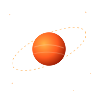

<div align="center">


<a href="https://github.com/Enrico_Bicca">
  
</a>



</div>

<table align="center">
<tr>
<td align="center" width="280">
  
  
</td>
<td>

```bash
$ cat sobre_mim.txt

nome      : Enrico Bicca
cargo     : Estudante de Cibersegurança
objetivo  : Analista SOC (N1 → N2 → Threat Hunter)
foco      : SIEM · Logs · MITRE ATT&CK · IR
status    : [■■■■■■□□□□] em evolução constante
```

</td>
<td align="center" width="200">
  
</td>
</tr>
</table>

<div align="center"></div>

## 🎯 Foco atual

```diff
+ Fundamentos de redes (TCP/IP, DNS, HTTP, ARP)
+ Análise de logs Windows e Linux
+ SIEM: Wazuh · Splunk · Elastic
+ MITRE ATT&CK e Cyber Kill Chain
+ Resposta a incidentes (NIST SP 800-61)
+ Python e Bash para automação
- Próximo passo: detection engineering com regras Sigma
```

## 🛠️ Arsenal

<div align="center">


</div>

## 🧪 Laboratórios e plataformas

| Plataforma | Trilha / Objetivo | Status |
|---|---|---|
| TryHackMe | SOC Level 1 | 🟧 em andamento |
| LetsDefend | Alertas de SOC | ⬜ planejado |
| CyberDefenders | Blue Team Labs | ⬜ planejado |
| Home Lab | Wazuh + Windows + Kali | 🟧 em construção |
| Certificação | Security+ / BTL1 | ⬜ planejado |

## 📂 Projetos em destaque

> Troque pelos seus repositórios conforme for publicando.

- 🔎 **home-lab-soc** — laboratório com SIEM, endpoints e simulação de ataques
- 📧 **phishing-analysis** — relatórios de análise de e-mails maliciosos
- 🐍 **ioc-enricher** — script Python para enriquecer IPs e hashes com APIs de threat intel
- 📝 **incident-reports** — post-mortems de investigações e playbooks

<div align="center"></div>

## 📊 Estatísticas

<div align="center">


</div>

## 🏅 Troféus

<div align="center">


</div>

## 📡 Contato

<div align="center">

[](https://linkedin.com/in/SEU_LINKEDIN)
[](https://tryhackme.com/p/SEU_USUARIO)
[](mailto:seu@email.com)

<br>

```text
Quem tem logs, tem respostas.
```


</div>

<!-- ============================================================
  IMAGENS (coloque na pasta assets/)
  - hacker-girl.gif : gif ou pixel art de uma hacker ruiva com laptop e
    óculos/fones. Procure no Pinterest, Giphy, Tenor ou ArtStation.
    Prefira fan art e dê crédito ao artista no fim do README.
  - Opcional: adicione mais decorações de tom laranja/vermelho,
    como fumaça, caixas, silhueta de rifle ou ícone de bomba em
    pixel art, sempre sem legenda ou nome da franquia.
  - Dica: se o fundo do gif for branco, remova em remove.bg ou ezgif.com.
  - Evite escrever nomes de franquias no alt, no nome do arquivo e nos commits.
============================================================ -->
